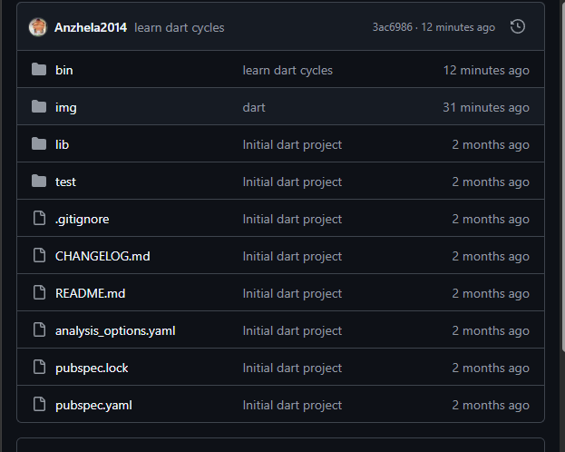
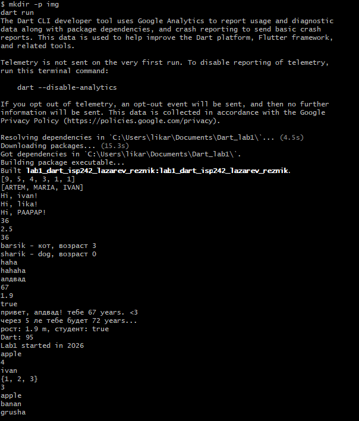
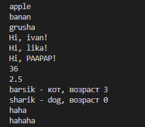
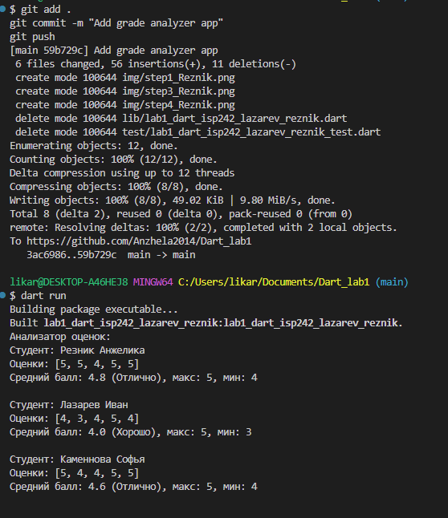

# Лабораторная работа №1. Основы языка Dart

консольное приложение на языке dart для изучения базового синтаксиса и анализа оценок студентов группы.

## Автор
Резник Анжелика Ильинична, группа ИСП-242

## Запуск
1. Клонировать репозиторий: `git clone https://github.com/Anzhela2014/Dart_lab1`
2. Перейти в папку: `cd Dart_lab1`
3. Установить зависимости: `dart pub get`
4. Запустить: `dart run`

## Что изучили
* базовый синтаксис dart и разницу между `var`, `final` и `const`
* как работает null safety и зачем нужны `?`, `?.` и `??`
* основные коллекции: списки `List`, словари `Map` и множества `Set`
* условия `if-else`, тернарный оператор, циклы `for`, `for-in`, `while` и `switch`

## Скриншоты работы

## Ответы на вопросы

1. **Чем статическая типизация Dart отличается от Python? Какое практическое преимущество она даёт?**  
   в python тип переменной определяется сам во время работы программы и может меняться на ходу, а в dart типы проверяются заранее ещё до запуска (на этапе компиляции). главное преимущество в том, что ошибки с несовпадением типов сразу подсвечиваются в редакторе, а не ломают приложение потом у пользователя, плюс код работает быстрее.

2. **Что означает `String?`? Чем отличается от `String`?**  
   `String` — это обычная строка, в которой всегда должно лежать какое-то текстовое значение и туда нельзя записать `null`. а `String?` означает nullable-тип, то есть переменная может хранить либо строку, либо пустоту `null`.

3. **Зачем в Dart `final`, если в Python можно просто договориться не менять переменную?**  
   в python это держится только на честном слове и любой может случайно перезаписать переменную и сломать логику. в dart слово `final` заставляет сам компилятор следить за этим и сразу выдаёт ошибку, если кто-то попытается изменить значение после присваивания.

4. **Чем именованный параметр `{required String name}` отличается от позиционного? Приведите пример вызова.**  
   позиционный параметр передаётся строго по порядку без указания имени, а именованный пишется в фигурных скобках и при вызове нужно явно написать его название (слово `required` делает его обязательным).  
   пример вызова: `describePet(name: 'Барсик', age: 3);`
